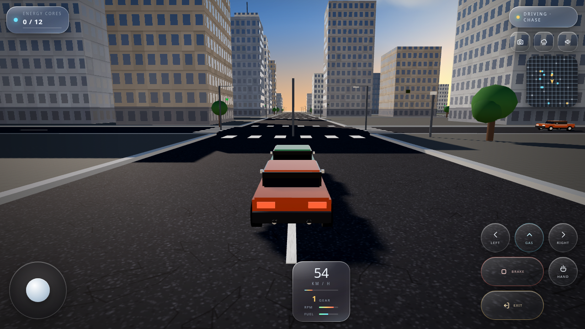
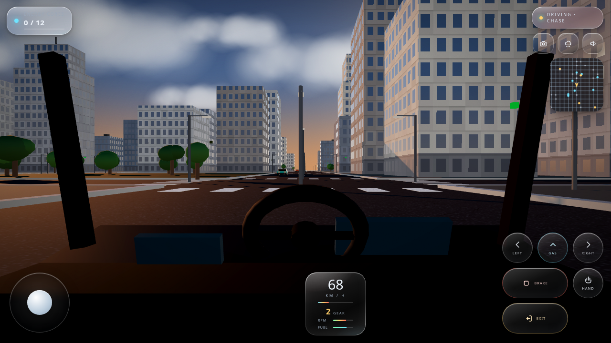
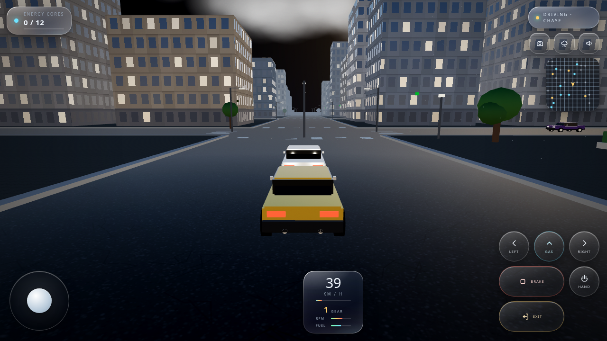
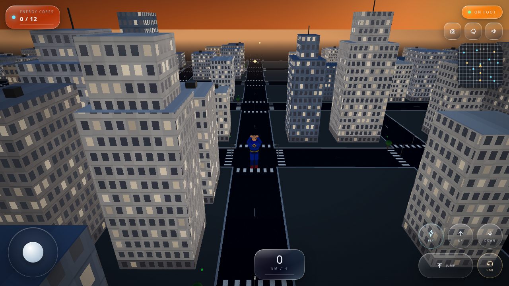
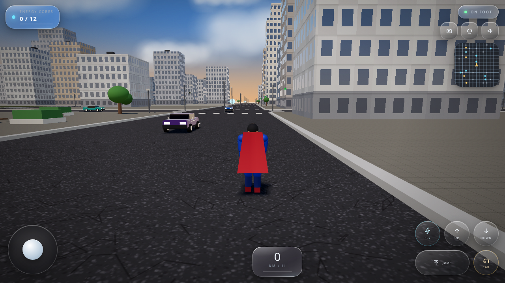
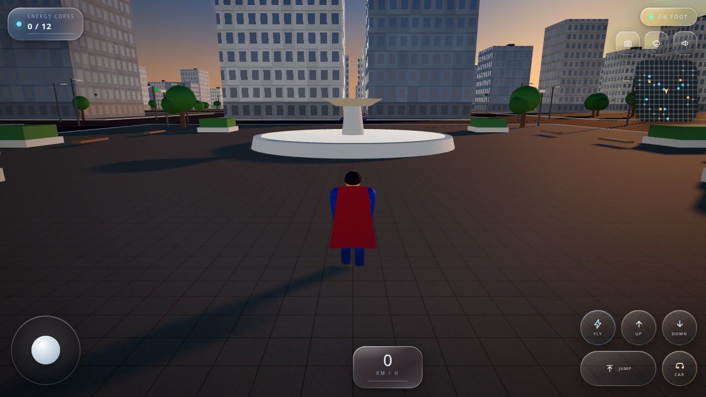

<div align="center">

<a href="https://github.com/technicalnihilist-lgtm/nova-city/stargazers"></a>&nbsp;<a href="https://github.com/technicalnihilist-lgtm/nova-city/network/members"></a>

<h3>NOVA CITY — open-world hero + driving game (WebGL) with a signed Android APK</h3>

   

<a href="https://github.com/technicalnihilist-lgtm/nova-city/releases/latest"></a>

<b>Support the work</b>

  

<sub>Donations aren't live yet — Paytm, UPI, PayPal and Buy&nbsp;Me&nbsp;a&nbsp;Coffee all show <b>coming soon</b>. Until then, a ⭐ star is the best support.</sub>

<a href="https://github.com/technicalnihilist-lgtm/nova-city/releases/latest"></a>  <a href="https://github.com/technicalnihilist-lgtm/nova-city/releases"></a>

<h4>Get it from</h4>

<a href="https://github.com/technicalnihilist-lgtm/nova-city/releases"></a> <a href="https://github.com/technicalnihilist-lgtm/nova-city/archive/refs/heads/main.zip"></a>

</div>

---

---

## Screenshots

All captured in-game at 1280x720 landscape, from the current build.

| | |
| --- | --- |
|  <br> **01 · Street canyon** — chase camera at 54 km/h |  <br> **02 · Cockpit** — wheel, cluster, A-pillars |
|  <br> **03 · Night rain** — wet road, headlights, lit windows |  <br> **04 · City aerial** — sunset over the grid |
|  <br> **05 · Street level** — traffic, signals, storefronts |  <br> **06 · Plaza** — fountain, benches, core hunt |

## What it is

- **Engine**: three.js (WebGL 2) — one self-contained HTML file, no network needed at runtime
- **Android shell**: a minimal `WebView` activity that loads the bundled game fullscreen, landscape, immersive
- **Size**: ~740 KB game + ~350 KB APK
- **Min SDK**: 24 (Android 7.0) · **Target SDK**: 34 · **Orientation**: landscape only

## Features

**On foot** — third-person hero, walk/run, jump, flight mode with climb/dive, animated cape and limbs.

**Driving** — 6-speed automatic gearbox with a torque curve and RPM, speed-sensitive steering, braking with an ABS-style lock release, reverse gear, handbrake drifting, fuel.

**Cameras** — chase, hood, and a full cockpit with a steering wheel that turns with the input. Cycle with the camera button (or `C`).

**World** — procedural city (249 buildings, parks, crosswalks, street lights, a plaza with a fountain), 19 parked cars.

**Traffic** — 18 AI vehicles that follow lanes, turn at intersections, obey the traffic signals (the lamps actually change colour), keep distance from each other and stop for the player.

**Day/night** — a full cycle every ~4 minutes: sun position and colour, street lamps, lit building windows, headlights.

**Weather** — clear / rain / fog, each changing lighting, fog density and the sky.

**UI** — liquid-glass HUD, spring/bounce animations, speedometer with gear, RPM and fuel, minimap, mission tracker.

## Controls

| Action | Touch | Keyboard |
| --- | --- | --- |
| Move / steer | left joystick | `WASD` / arrows |
| Look | drag the scene | mouse drag |
| Jump | Jump button | `Space` |
| Fly toggle | Fly button | `F` |
| Climb / dive | Up / Down buttons | — |
| Enter / exit car | ⚡ Car button | `E` |
| Handbrake | Hand button | `Q` |
| Camera | camera button | `C` |
| Weather | weather button | `R` |
| Horn | horn button | `H` |

## Install the APK

```bash
adb install -r build/nova-city.apk
```

Or copy `build/nova-city.apk` to the phone and open it (allow "install from unknown sources").

The bundled APK is signed with a local debug key — fine for sideloading, not for Play Store publishing.

## Build from source

**Game only** (produces `game/dist/game.html`, open it in any browser):

```bash
python3 game/build.py
```

**APK** (needs JDK 17 + Android SDK build-tools 34 and platform 34):

```bash
export ANDROID_SDK=/path/to/android-sdk
export JAVA_HOME=/path/to/jdk-17
./android/build_apk.sh
```

## Layout

```
game/src/shell.html      HUD, CSS (liquid glass), start screen
game/src/world.js        renderer, sky, city generation, hero + car models, cockpit, rain
game/src/gameplay.js     input, physics, traffic AI, day/night, weather, cameras, HUD logic
game/vendor/three.min.js three.js r157 (MIT)
android/app/             manifest, WebView activity, launcher icons
build/nova-city.apk      signed build
```

## Rendering notes

Screenshots come straight from the WebGL renderer — no post-processing, no painted art. The look comes from
PBR materials with an IBL environment built from the sky shader, a procedural window/storefront shader on the
instanced facades, golden-hour sun with soft shadow maps, fog matched to the horizon, drifting cloud sprites,
and a wet-road response that kicks in while it rains.

## Honest scope

This is a browser-engine game wrapped in a WebView, not a Unity project. Not implemented: vehicle damage, garage/customisation, doors and bonnet animation, manual transmission with clutch, pedestrians, career/mission modes, save/load, multiple vehicle body types, and LOD/streaming (the world is instanced and frustum-culled instead). Performance is untested on very low-end hardware.

The hero is an original "man-of-steel"-style character. No DC/Warner assets, logos or models are used or included.

three.js is MIT licensed — see `game/vendor/`.

---

---

## 🌍 Languages

<sub>Donations are <b>coming soon</b> in every language below — nothing to pay today, nothing to click.</sub>

<div align="center">

<sub><b>हिन्दी · বাংলা · मराठी · తెలుగు · தமிழ் · ગુજરાતી · ಕನ್ನಡ · മലയാളം · ਪੰਜਾਬੀ · ଓଡ଼ିଆ · অসমীয়া · اردو</b></sub>

</div>

<details>
<summary><b>🌍 Open the same message in 53 languages</b></summary>

**🇮🇳 Indian languages**

- **हिन्दी** (Hindi) — ☕ जल्द ही आ रहा है। · ⭐ अगर आपको यह ऐप और हमारा काम पसंद है, तो कृपया रिपॉजिटरी को स्टार दें और हमें फॉलो करें।
- **বাংলা** (Bengali) — ☕ খুব শিগগিরই আসছে। · ⭐ যদি আপনার এই অ্যাপ এবং আমাদের কাজ ভালো লাগে, তবে অনুগ্রহ করে রিপোজিটরিটিকে একটি স্টার দিন এবং আমাদের ফলো করুন।
- **मराठी** (Marathi) — ☕ लवकरच येत आहे. · ⭐ जर तुम्हाला हे ॲप आणि आमचं काम आवडलं असेल, तर कृपया रिपॉझिटरीला स्टार द्या आणि आम्हाला फॉलो करा.
- **తెలుగు** (Telugu) — ☕ త్వరలో రాబోతోంది. · ⭐ మీకు ఈ యాప్, మా పని నచ్చితే, దయచేసి రిపోజిటరీకి ఒక స్టార్ ఇచ్చి మమ్మల్ని ఫాలో అవ్వండి.
- **தமிழ்** (Tamil) — ☕ விரைவில் வருகிறது. · ⭐ உங்களுக்கு இந்த ஆப்பும் எங்க வேலையும் பிடிச்சிருந்தா, தயவுசெஞ்சு இந்த ரெபாசிட்டரிக்கு ஒரு ஸ்டார்…
- **ગુજરાતી** (Gujarati) — ☕ ટૂંક સમયમાં આવી રહ્યું છે. · ⭐ જો તમને આ એપ અને અમારું કામ ગમતું હોય, તો પ્લીઝ રિપોઝિટરીને સ્ટાર આપો અને અમને ફોલો કરો.
- **ಕನ್ನಡ** (Kannada) — ☕ ಶೀಘ್ರದಲ್ಲೇ ಬರುತ್ತಿದೆ. · ⭐ ನಿಮಗೆ ಈ ಆ್ಯಪ್ ಮತ್ತು ನಮ್ಮ ಕೆಲಸ ಇಷ್ಟವಾದರೆ, ದಯವಿಟ್ಟು ರೆಪೊಸಿಟರಿಗೆ ಸ್ಟಾರ್ ಕೊಡಿ ಮತ್ತು ನಮ್ಮನ್ನು ಫಾಲೋ ಮಾಡಿ.
- **മലയാളം** (Malayalam) — ☕ ഉടൻ വരുന്നു. · ⭐ നിങ്ങൾക്ക് ഈ ആപ്പും ഞങ്ങളുടെ പ്രവർത്തനവും ഇഷ്ടപ്പെട്ടെങ്കിൽ, ദയവായി റെപ്പോസിറ്ററിക്ക് ഒരു സ്റ്റാർ…
- **ਪੰਜਾਬੀ** (Punjabi) — ☕ ਜਲਦੀ ਆ ਰਿਹਾ ਹੈ। · ⭐ ਜੇ ਤੁਹਾਨੂੰ ਇਹ ਐਪ ਅਤੇ ਸਾਡਾ ਕੰਮ ਪਸੰਦ ਹੈ, ਤਾਂ ਕਿਰਪਾ ਕਰਕੇ ਰਿਪੋਜ਼ਟਰੀ ਨੂੰ ਸਟਾਰ ਦਿਓ ਅਤੇ ਸਾਨੂੰ ਫਾਲੋ ਕਰੋ।
- **ଓଡ଼ିଆ** (Odia) — ☕ ଖୁବ୍ ଶୀଘ୍ର ଆସୁଛି। · ⭐ ଯଦି ଆପଣଙ୍କୁ ଏହି ଆପ୍ ଏବଂ ଆମର କାମ ଭଲ ଲାଗୁଛି, ତେବେ ଦୟାକରି ରିପୋଜିଟୋରୀକୁ ଗୋଟିଏ ଷ୍ଟାର୍ ଦିଅନ୍ତୁ ଏବଂ ଆମକୁ ଫଲୋ କରନ୍ତୁ।
- **অসমীয়া** (Assamese) — ☕ অতি সোনকালেই আহি আছে। · ⭐ যদি আপুনি এই এপটো আৰু আমাৰ কাম ভাল পায়, তেন্তে অনুগ্ৰহ কৰি ৰিপজিটৰীটোক এটা ষ্টাৰ দিয়ক আৰু আমাক ফ'ল' কৰক।
- **اردو** (Urdu) — ☕ جلد آرہا ہے۔ · ⭐ اگر آپ کو یہ ایپ اور ہمارا کام پسند آئے تو براہ کرم ریپازٹری کو سٹار دیں اور ہمیں فالو کریں۔
- **संस्कृतम्** (Sanskrit) — ☕ शीघ्रमेव आगच्छति।
- **मैथिली** (Maithili) — ☕ जल्दिये आबि रहल अछि।
- **कोंकणी** (Konkani) — ☕ रोखडेंच येता.
- **کٲشُر** (Kashmiri) — ☕ جَلدی یِوان چھُ۔
- **سنڌي** (Sindhi) — ☕ जल्द अची रह्यो आहे।
- **डोगरी** (Dogri) — ☕ जल्दी आ करदा ऐ।
- **ꯃꯤꯇꯩ ꯂꯣꯟ** (Manipuri) — ☕ ꯑꯊꯨꯕꯥ ꯃꯇꯝꯗꯥ ꯂꯥꯛꯀꯅꯤ꯫
- **बर’** (Bodo) — ☕ थाबैनो फैगोन।
- **ᱥᱟᱱᱛᱟᱲᱤ** (Santali) — ☕ ᱞᱚᱜᱚᱱ ᱦᱤᱡᱩᱜ ᱠᱟᱱᱟ᱾
- **नेपाली** (Nepali) — ☕ छिट्टै आउँदैछ। · ⭐ यदि तपाईंलाई यो एप र हाम्रो काम मन पर्‍यो भने, कृपया रिपोजिटरीलाई स्टार दिनुहोस् र हामीलाई फलो गर्नुहोस्।

**🌍 World languages**

- **العربية** (Arabic) — ☕ قريبًا. · ⭐ إذا أعجبك هذا التطبيق وعملنا، فيرجى منح المستودع نجمة ومتابعتنا.
- **简体中文** (Chinese (Simplified)) — ☕ 即将推出。
- **繁體中文** (Chinese (Traditional)) — ☕ 即將推出。
- **Čeština** (Czech) — ☕ Již brzy.
- **Dansk** (Danish) — ☕ Kommer snart.
- **Nederlands** (Dutch) — ☕ Binnenkort beschikbaar. · ⭐ Vind je deze app en ons werk leuk?
- **Filipino** (Filipino) — ☕ Malapit na.
- **Suomi** (Finnish) — ☕ Tulossa pian.
- **Français** (French) — ☕ Bientôt disponible. · ⭐ Si cette application et notre travail vous plaisent, mettez une étoile au dépôt et suivez-nous.
- **Deutsch** (German) — ☕ Bald verfügbar. · ⭐ Wenn dir diese App und unsere Arbeit gefallen, gib dem Repository einen Stern und folge uns.
- **Ελληνικά** (Greek) — ☕ Έρχεται σύντομα.
- **עברית** (Hebrew) — ☕ בקרוב.
- **Magyar** (Hungarian) — ☕ Hamarosan.
- **Bahasa Indonesia** (Indonesian) — ☕ Segera hadir. · ⭐ Jika kamu suka aplikasi ini dan karya kami, beri bintang pada repositori ini dan ikuti kami.
- **Italiano** (Italian) — ☕ In arrivo.
- **日本語** (Japanese) — ☕ 近日公開。 · ⭐ このアプリと私たちの仕事が気に入ったら、リポジトリにスターを付けてフォローしてください。
- **한국어** (Korean) — ☕ 곧 공개됩니다. · ⭐ 이 앱과 저희 작업이 마음에 드신다면 저장소에 스타를 눌러 주시고 팔로우해 주세요.
- **Bahasa Melayu** (Malay) — ☕ Akan datang.
- **Norsk** (Norwegian) — ☕ Kommer snart.
- **فارسی** (Persian) — ☕ به‌زودی.
- **Polski** (Polish) — ☕ Wkrótce. · ⭐ Jeśli podoba Ci się ta aplikacja i nasza praca, daj repozytorium gwiazdkę i obserwuj nas.
- **Português** (Portuguese) — ☕ Em breve.
- **Română** (Romanian) — ☕ În curând.
- **Русский** (Russian) — ☕ Скоро. · ⭐ Если вам нравится это приложение и наша работа, поставьте звёздочку репозиторию и подпишитесь на нас.
- **Español** (Spanish) — ☕ Muy pronto. · ⭐ Si te gusta esta app y nuestro trabajo, dale una estrella al repositorio y síguenos.
- **Kiswahili** (Swahili) — ☕ Inakuja hivi karibuni.
- **Svenska** (Swedish) — ☕ Kommer snart.
- **ไทย** (Thai) — ☕ เร็ว ๆ นี้
- **Türkçe** (Turkish) — ☕ Çok yakında.
- **Українська** (Ukrainian) — ☕ Незабаром.
- **Tiếng Việt** (Vietnamese) — ☕ Sắp ra mắt. · ⭐ Nếu bạn thích ứng dụng này và công việc của chúng tôi, hãy tặng kho lưu trữ một ngôi sao và theo…

</details>

