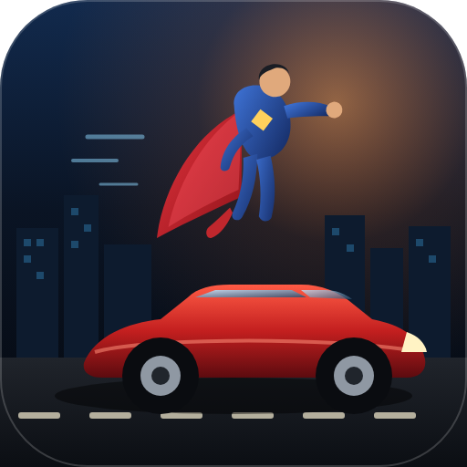
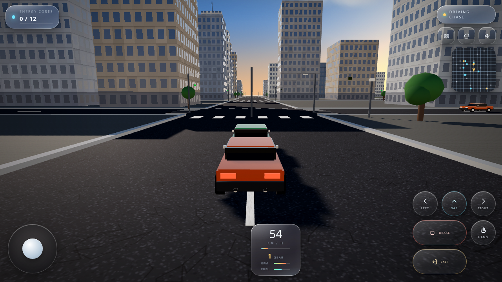
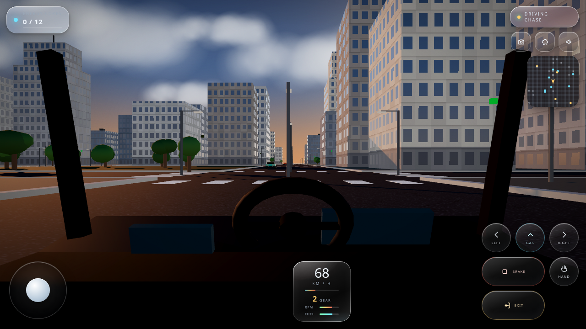
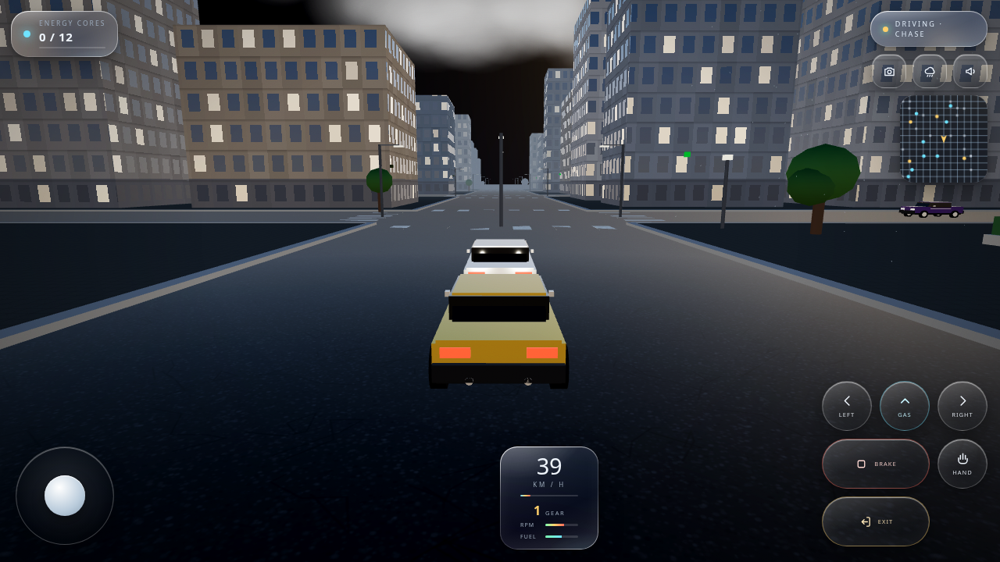
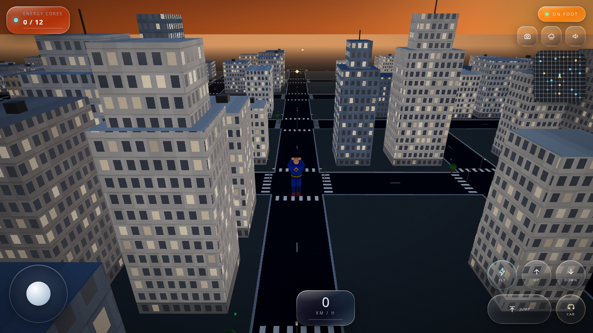
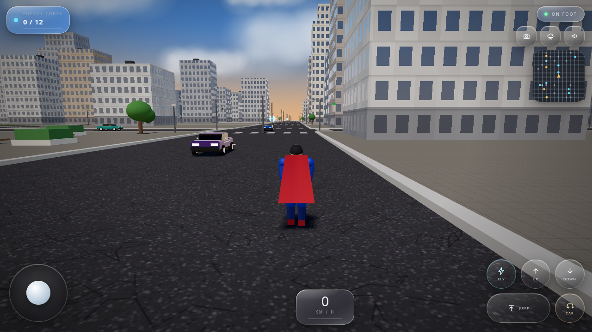
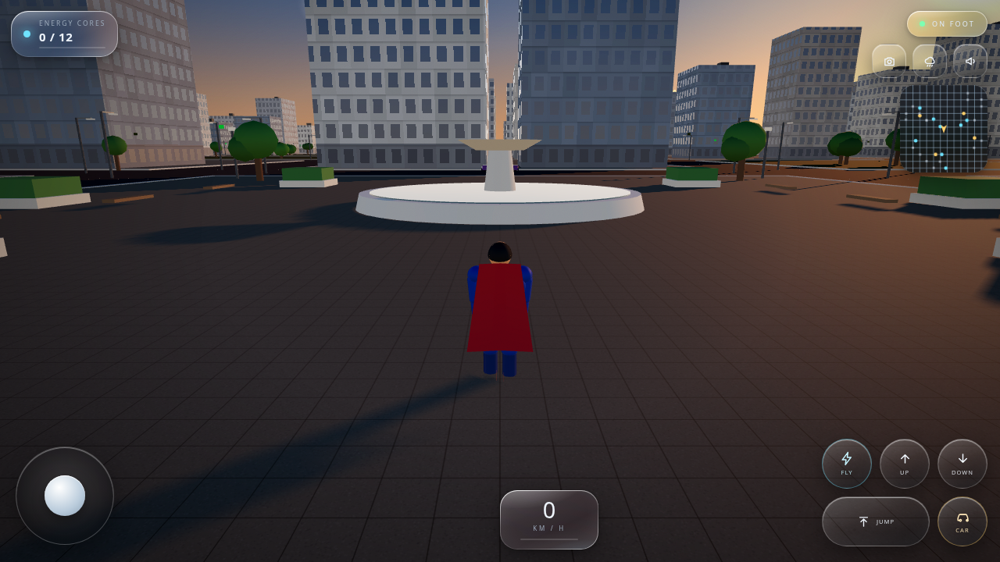

# NOVA CITY

A 3D open-world hero + driving game that runs entirely in a WebGL canvas, packaged as an installable Android APK.




## Screenshots

All captured in-game at 1280x720 landscape, from the current build.

| | |
| --- | --- |
|  <br> **01 · Street canyon** — chase camera at 54 km/h |  <br> **02 · Cockpit** — wheel, cluster, A-pillars |
|  <br> **03 · Night rain** — wet road, headlights, lit windows |  <br> **04 · City aerial** — sunset over the grid |
|  <br> **05 · Street level** — traffic, signals, storefronts |  <br> **06 · Plaza** — fountain, benches, core hunt |

## What it is

- **Engine**: three.js (WebGL 2) — one self-contained HTML file, no network needed at runtime
- **Android shell**: a minimal `WebView` activity that loads the bundled game fullscreen, landscape, immersive
- **Size**: ~740 KB game + ~350 KB APK
- **Min SDK**: 24 (Android 7.0) · **Target SDK**: 34 · **Orientation**: landscape only

## Features

**On foot** — third-person hero, walk/run, jump, flight mode with climb/dive, animated cape and limbs.

**Driving** — 6-speed automatic gearbox with a torque curve and RPM, speed-sensitive steering, braking with an ABS-style lock release, reverse gear, handbrake drifting, fuel.

**Cameras** — chase, hood, and a full cockpit with a steering wheel that turns with the input. Cycle with the camera button (or `C`).

**World** — procedural city (249 buildings, parks, crosswalks, street lights, a plaza with a fountain), 19 parked cars.

**Traffic** — 18 AI vehicles that follow lanes, turn at intersections, obey the traffic signals (the lamps actually change colour), keep distance from each other and stop for the player.

**Day/night** — a full cycle every ~4 minutes: sun position and colour, street lamps, lit building windows, headlights.

**Weather** — clear / rain / fog, each changing lighting, fog density and the sky.

**UI** — liquid-glass HUD, spring/bounce animations, speedometer with gear, RPM and fuel, minimap, mission tracker.

## Controls

| Action | Touch | Keyboard |
| --- | --- | --- |
| Move / steer | left joystick | `WASD` / arrows |
| Look | drag the scene | mouse drag |
| Jump | Jump button | `Space` |
| Fly toggle | Fly button | `F` |
| Climb / dive | Up / Down buttons | — |
| Enter / exit car | ⚡ Car button | `E` |
| Handbrake | Hand button | `Q` |
| Camera | camera button | `C` |
| Weather | weather button | `R` |
| Horn | horn button | `H` |

## Install the APK

```bash
adb install -r build/nova-city.apk
```

Or copy `build/nova-city.apk` to the phone and open it (allow "install from unknown sources").

The bundled APK is signed with a local debug key — fine for sideloading, not for Play Store publishing.

## Build from source

**Game only** (produces `game/dist/game.html`, open it in any browser):

```bash
python3 game/build.py
```

**APK** (needs JDK 17 + Android SDK build-tools 34 and platform 34):

```bash
export ANDROID_SDK=/path/to/android-sdk
export JAVA_HOME=/path/to/jdk-17
./android/build_apk.sh
```

## Layout

```
game/src/shell.html      HUD, CSS (liquid glass), start screen
game/src/world.js        renderer, sky, city generation, hero + car models, cockpit, rain
game/src/gameplay.js     input, physics, traffic AI, day/night, weather, cameras, HUD logic
game/vendor/three.min.js three.js r157 (MIT)
android/app/             manifest, WebView activity, launcher icons
build/nova-city.apk      signed build
```

## Rendering notes

Screenshots come straight from the WebGL renderer — no post-processing, no painted art. The look comes from
PBR materials with an IBL environment built from the sky shader, a procedural window/storefront shader on the
instanced facades, golden-hour sun with soft shadow maps, fog matched to the horizon, drifting cloud sprites,
and a wet-road response that kicks in while it rains.

## Honest scope

This is a browser-engine game wrapped in a WebView, not a Unity project. Not implemented: vehicle damage, garage/customisation, doors and bonnet animation, manual transmission with clutch, pedestrians, career/mission modes, save/load, multiple vehicle body types, and LOD/streaming (the world is instanced and frustum-culled instead). Performance is untested on very low-end hardware.

The hero is an original "man-of-steel"-style character. No DC/Warner assets, logos or models are used or included.

three.js is MIT licensed — see `game/vendor/`.
